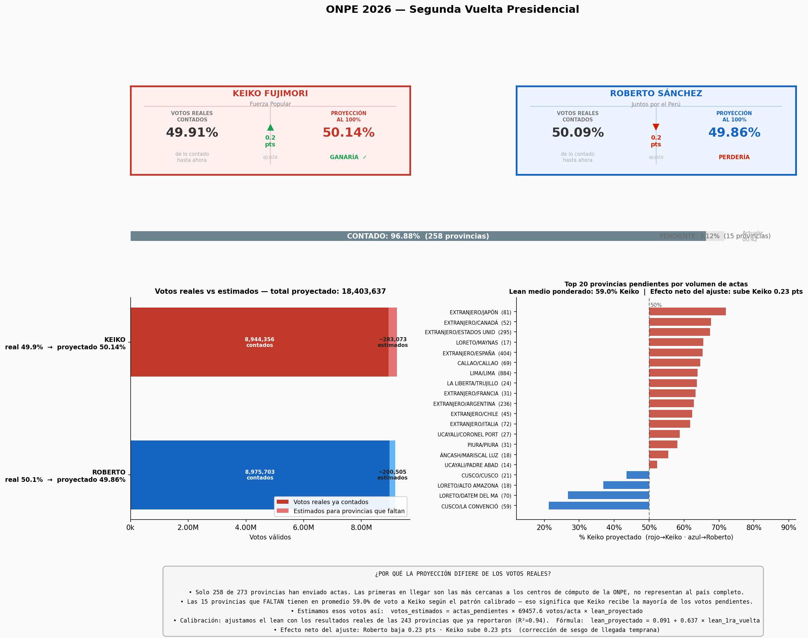
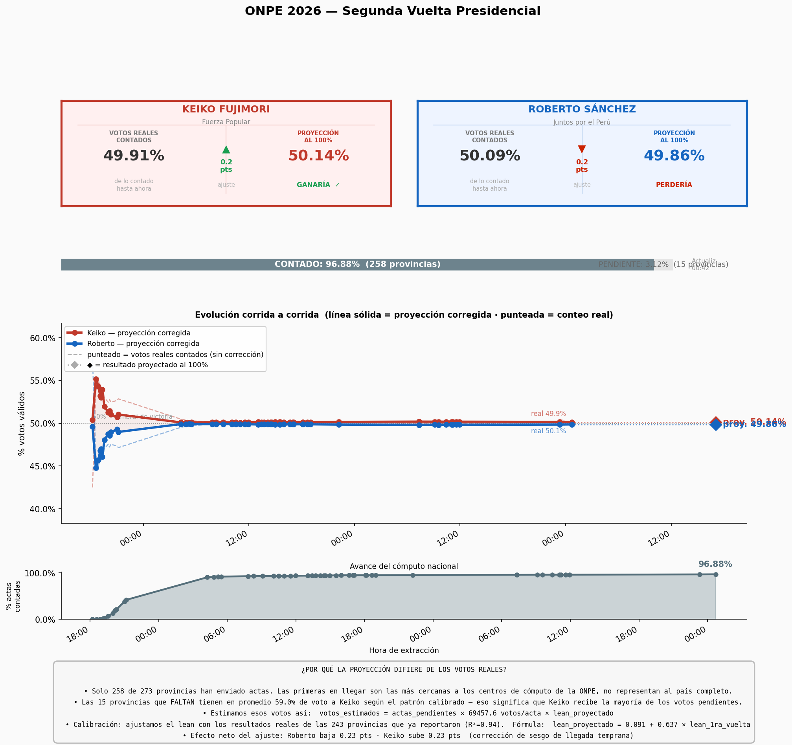

# Perú Electoral Analytics 2026

Proyecto personal de análisis de datos sobre las Elecciones Generales 2026 en Perú. Extrae resultados públicos de la ONPE, guarda cada corte y estima el resultado final según el avance de actas.

> Proyecto independiente y educativo. No está vinculado con la ONPE. Las proyecciones son estimaciones; el resultado oficial es el que publica la ONPE.



## Qué hace

**Primera vuelta**

- `extractor_onpe.py`: consulta los endpoints públicos de resultados y guarda cada corte en Excel.
- `Analizador de Tendencia Regional ONPE 2026.py`: separa resultados nacionales y del extranjero, guarda el historial en CSV y genera gráficos de tendencia.
- `simulador_onpe.py`: simulación Monte Carlo de 10,000 iteraciones para estimar la probabilidad de cada candidato según los votos pendientes.
- `orquestador_onpe.py`: ejecuta los tres scripts en conjunto.

**Segunda vuelta**

- `segunda_vuelta_proyeccion.py`: descarga resultados de 196 provincias y de los países del exterior, proyecta cada unidad al 100 % de actas y guarda cada corrida en SQLite.
- `analisis_sv.py`: corrige el sesgo de llegada temprana. Usa el resultado de primera vuelta como referencia, lo calibra con las provincias que ya reportaron mediante una regresión lineal y genera los gráficos.



## Tecnologías

Python, requests, pandas, NumPy, Matplotlib, SQLite, CSV, JSON y Excel.

## Cómo ejecutarlo

```bash
pip install -r requirements.txt
cd segunda_vuelta
python analisis_sv.py
```

`analisis_sv.py` necesita la base `onpe_sv_resultados.db`, que se crea al ejecutar `segunda_vuelta_proyeccion.py`. Los endpoints de la ONPE pueden cambiar o dejar de responder después del proceso electoral. El repositorio incluye CSV de muestra en `segunda_vuelta/`.

## Lo que aprendí

- Consumir APIs JSON públicas y manejar sus cambios de estructura.
- Guardar series de tiempo en CSV y SQLite para comparar cortes.
- Detectar sesgo en datos parciales: las primeras actas no representan a todo el país.
- Explicar un modelo con gráficos legibles para personas no técnicas.

## Autor

Yonatan Martel · [LinkedIn](https://www.linkedin.com/in/yonatan-alfredo-2696b4237) · [GitHub](https://github.com/Yonidv)
